# Standby

**Your Claude Code, right beside you.**

Standby is a Claude Code plugin that gives your session ears and a voice, on your Mac.

<p align="center"></p>

- **Call it** and talk things through. It does the real work in your session while you keep talking.
- **Bring it to meetings**, on a call or in the room, with no bot in the call. Ask it anything as it goes.
- **Dictate anywhere.** Press F5, speak, and the text lands where your cursor is.

Speech-to-text, speaker labels and the voice run on your Mac. Your Claude Code gets your words as text.

## Install

The easy way: give your Claude Code the link to [AGENT-GUIDE.md](AGENT-GUIDE.md) and ask it to install Standby. The guide
tells an agent how to set it up, use every part of it, fix problems and remove it.

Or by hand:

```bash
git clone https://github.com/mksadoughi/standby.git
cd standby && ./install.sh
```

The installer sets everything up and downloads the models once. After that, its speech models run offline; only your Claude Code talks to its model provider, as always.

## What it needs

- **A Mac**: Apple Silicon, macOS 14 or later, and [Claude Code](https://docs.anthropic.com/en/docs/claude-code) 2.1.299 or later,
  signed in (`claude update` gets the latest). 16 GB of memory is best for calls.
- **A one-time download** of about 4.5 GB (2.5 GB on an 8 GB Mac), so leave 5 GB free. Standby's voice, 240 MB of
  it, comes with your first call.
- **Three permissions**, each asked the first time it's needed:

  | macOS asks for | When | Why |
  |---|---|---|
  | Microphone | Your first call or meeting | To hear you |
  | Screen & System Audio Recording | The first meeting that records your Mac's sound | To hear the other side of a video call. Standby takes the sound only, never the screen |
  | Input Monitoring and Accessibility | When you turn on dictation | To notice your dictation shortcut, and to type the text for you |

- **Consent**: tell people when you're transcribing. In many places everyone in a conversation has to agree to being
  recorded.
- **Nothing to pay per use**: Standby is free and needs no API key. What it asks of Claude goes through your own
  Claude Code and its subscription. [Will it drain my plan?](#will-it-drain-my-claude-plan)

### Will it drain my Claude plan?

Hardly. Speech-to-text, speaker labels and the voice all run on your Mac. Claude gets your words as text, and
conversation is a small amount of text. People speak two or three words a second. Even if you stayed on a call for a
whole eight-hour workday and never stopped talking, everything said would come to around 100,000 tokens. That's
about what Claude reads when it looks over a medium-sized codebase once.

And most of that goes to Haiku, the smallest and lightest model. The call's quick replies run on Haiku, while the
heavier work you hand your session counts there, as usual.

In my own use, a full day of about ten calls took 1 to 2% of a $20 Pro plan's weekly limit. Settings > Usage shows
exactly what Standby used.

## Use it

In Claude Code, just ask: **"call me"** or **"listen to this meeting"**. Or type it yourself:

| | |
|---|---|
| `/standby call` | Start a voice call. Ask for real work and it arrives in the chat, marked "from your call" |
| `/standby listen` | Listen to a meeting. Ask Claude about it in the same chat; the summary shows when it ends |
| `/standby window` | Open the call or meeting in Standby's own window, with names and the live transcript |
| `/standby settings` | Change a setting, or just ask Claude |

Put a call away and it waits in a mini window in the corner of your screen. Point at it for Pause, End and Full window.

Dictation is off until you turn it on in Standby's Settings.

## More

<details>
<summary><b>Update or uninstall</b></summary>

Update:

```bash
cd standby && git pull && ./install.sh
```

Then quit and reopen Standby, and start a new Claude Code session (or run `/reload-plugins`). Your meetings, calls
and settings stay.

Uninstall:

```bash
standby dictation off
claude plugin uninstall standby@standby && claude plugin marketplace remove standby
rm -rf ~/.standby ~/Applications/Standby.app "$HOME/Applications/Standby Dictation.app"
rm -f ~/.local/bin/standby ~/.local/bin/standby-ctx
```

This deletes your meetings and calls too; copy `~/.standby/sessions` first to keep them. The models are in
`~/.cache/huggingface/hub` (the `parakeet`, `whisper` and `pocket-tts` folders).
</details>

<details>
<summary><b>Privacy</b></summary>

- **Audio** stays on your Mac and is transcribed there. Standalone dictation isn't kept as a session; when it uses a
  running recorder, temporary audio and text files can remain after an interruption. Dictated questions within a
  meeting or call are part of that session.
- **Transcripts, calls and summaries** are saved in `~/.standby/sessions/`. `standby purge <session>` deletes one.
- **Text to Claude**: a meeting's transcript and what you say on a call go to your own Claude Code, which talks to
  its model provider as it always does.
- **Voice prints** stay on your Mac: the voices you name, and your own voice, which Standby learns from your calls to
  tell you apart. Turn this off or forget them in Settings > Recording.
- **What you send:** your words go to your Claude Code as text, along with anything you paste or attach. Claude Code
  and its tools handle data their own way.
- **Logs** keep operational diagnostics without routinely copying conversation text. Optional debug call traces
  contain words and replies in the session's folder. Older logs can still contain conversation text; review logs
  and traces before sharing them, since diagnostics can also include local paths, device names and error details.
- **Deleting** a meeting or call in Standby removes its session files and Standby's delivered copies, including its
  debug trace. It doesn't erase global diagnostic logs, what was already sent to Claude Code, or exports.
- Standby has no account and no telemetry. It only downloads its models, from Hugging Face and GitHub.
</details>

<details>
<summary><b>Troubleshooting</b></summary>

| Problem | Fix |
|---|---|
| `/standby` isn't there | Start a new Claude Code session, or run `/reload-plugins`. Check `claude --version` is 2.1.299 or later (`claude update`). Still missing: run `./install.sh` again |
| The transcript stays empty | Allow Standby in System Settings > Privacy & Security > Microphone |
| The other side of a call is missing | Allow Standby in System Settings > Privacy & Security > Screen & System Audio Recording, then reopen it |
| "Claude can't sign in" | Run `claude`, then `/login` |
| F5 does nothing | Settings > Dictation says what's missing, with a button to fix each |
| Anything else | `standby check`, and the logs in `~/.standby` (`ui.log`, `daemon.log`, `dictation.log`) |
| A call felt slow, or answered something else | Set `"debug": {"call_trace": true}` in `~/.standby/config.json`; the next calls keep a trace, and `python3 tools/call_trace.py <session>` shows where each turn's time went |

`standby help` lists the terminal commands.
</details>

<details>
<summary><b>How it's built</b></summary>

```
install.sh   the installer
lite/        the Claude Code plugin: /standby, the line above the prompt, Standby's tools for Claude
mac/         the app: recorder, speech-to-text, speakers, the window, the mini window, the voice, dictation
plugin/      the meeting agent and the transcript reader Claude Code uses
docs/        the website
tests/       the test suites (no microphone needed)
```

Models, all on your Mac: NVIDIA Parakeet for speech-to-text, NVIDIA
[Nemotron-3-Diarization](https://huggingface.co/nvidia/Nemotron-3-Diarization)
([Core ML build](https://huggingface.co/FluidInference/nemotron-3-diarization-coreml)) and TitaNet for speakers,
`whisper-large-v3-turbo` for a better transcript afterwards, and [Pocket TTS](https://huggingface.co/kyutai/pocket-tts)
by Kyutai for the voice, with [Smart Turn](https://github.com/pipecat-ai/smart-turn) and
[Silero VAD](https://github.com/snakers4/silero-vad) for turn-taking.

Run the tests with `PY=~/.standby/venv/bin/python bash tests/run_all.sh`. See [CONTRIBUTING.md](CONTRIBUTING.md),
[SECURITY.md](SECURITY.md) and [CHANGELOG.md](CHANGELOG.md).
</details>

## License

MIT, see [LICENSE](LICENSE). The models keep their own licenses: Pocket TTS under
[CC BY 4.0](https://creativecommons.org/licenses/by/4.0/), Nemotron-3-Diarization's Core ML build under the
[OpenMDW License 1.1](https://github.com/OpenMDW/OpenMDW/blob/main/1.1/LICENSE.OpenMDW-1.1). Every model,
its source, pinned revision and license, and the code Standby adapts from other projects, are in
[THIRD_PARTY_NOTICES.md](THIRD_PARTY_NOTICES.md).

Standby is an independent project, not affiliated with or endorsed by Anthropic. Claude and Claude Code are
trademarks of Anthropic.
